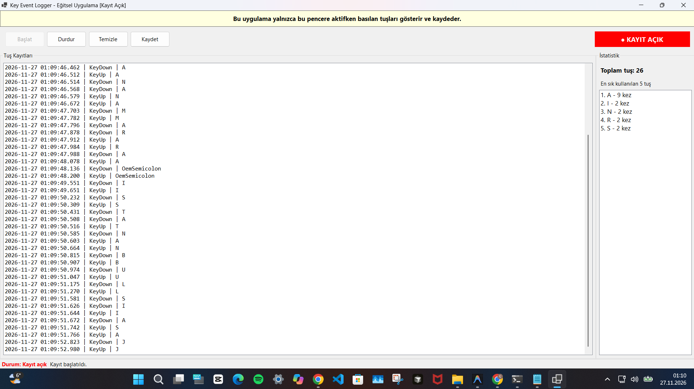
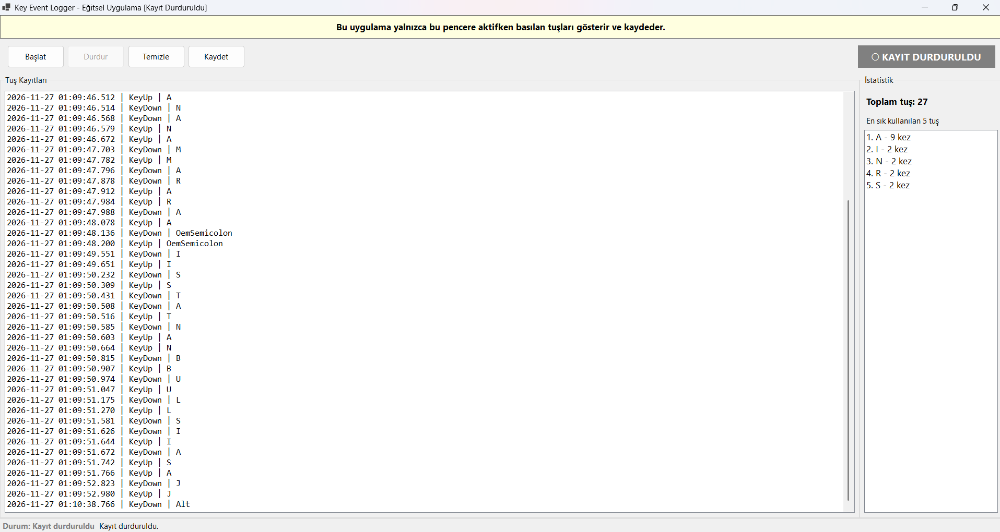
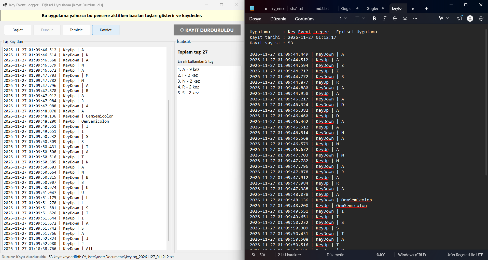

# Key Event Logger (Eğitsel Keylogger)

**Nesne Tabanlı Programlama (YMH 219)** dersi ödevi.

Bu proje, klavye olaylarının (KeyDown / KeyUp) bir Windows Forms uygulamasında nasıl yakalandığını ve olay bilgilerinin uygulama içinde nasıl işlendiğini göstermek için geliştirilmiştir. Uygulama **yalnızca kendi penceresi aktifken** basılan tuşları, tuş adı ve zaman bilgisiyle listeler ve kullanıcı isterse kayıtları yerel bir `.txt` dosyasına kaydeder.

> Bu uygulama yalnızca bu pencere aktifken basılan tuşları gösterir ve kaydeder.

---

## Kullanılan Teknolojiler

| Öğe | Açıklama |
|---|---|
| Dil | C# |
| Platform | .NET 8 (`net8.0-windows`) |
| Arayüz | Windows Forms |
| Geliştirme ortamı | Visual Studio 2022 |
| NuGet paketleri | **Harici paket yok** (yalnızca .NET'in kendi kütüphaneleri) |

## Kurulum ve Çalıştırma

**Gereksinimler:** Windows 10/11, Visual Studio 2022 (".NET masaüstü geliştirme" iş yükü) veya .NET 8 SDK.

1. Depoyu klonlayın:
   ```bash
   git clone https://github.com/Mehmet-ali4/YMH219-KeyEventLogger.git
   cd YMH219-KeyEventLogger
   ```
2. `YMH219-KeyEventLogger.sln` dosyasını Visual Studio ile açın.
3. **F5** (veya *Başlat*) ile çalıştırın.

Komut satırından çalıştırmak için:
```bash
dotnet run --project KeyEventLogger
```

Projede mutlak dosya yolu ve harici paket bulunmadığından ek bir ayar gerekmez.

## Temel Özellikler

- **Tuş kaydı:** Pencere aktifken basılan tuşun adı, olay türü (KeyDown/KeyUp) ve milisaniyeli zaman bilgisi listede gösterilir.
- **Kayıt formatı** (ekranda ve dosyada aynı):
  ```
  2026-11-27 00:40:12.345 | KeyDown | Ctrl+A
  ```
- **Okunabilir tuş adları:** `Ctrl+`, `Shift+`, `Alt+` önekleri; `Return → Enter`, `Back → Backspace`, `D1 → 1` gibi eşlemeler.
- **Başlat / Durdur:** Kayıt durumu butonlarla kontrol edilir; durdurulmuşken basılan tuşlar listeye eklenmez.
- **Kayıt durumu göstergesi:** Kırmızı `● KAYIT AÇIK` / gri `○ KAYIT DURDURULDU` etiketi; durum ayrıca durum çubuğunda ve pencere başlığında görünür.
- **Basılı tutma kontrolü:** Bir tuş basılı tutulduğunda tekrarlanan KeyDown olayları kaydedilmez (tek kayıt).
- **Özel tuşlar:** Tab, Enter, Esc ve ok tuşları `ProcessCmdKey` ile yakalanır; çift kayıt oluşmaz.
- **Temizle:** Onay sorusundan sonra ekrandaki kayıtlar ve istatistikler silinir.
- **Kaydet:** Kayıtlar, kullanıcının `SaveFileDialog` ile seçtiği yola UTF-8 `.txt` olarak yazılır (varsayılan ad `keylog_yyyyMMdd_HHmmss.txt`). Dosyanın başında uygulama adı, kayıt tarihi ve kayıt sayısı bulunur.
- **Hata yönetimi:** Yetki, disk veya geçersiz yol hatalarında uygulama kapanmaz; anlaşılır bir mesaj gösterilir.
- **İstatistik:** Toplam tuş sayısı ve en sık kullanılan 5 tuş, her yeni kayıtta güncellenir.
- **Çıkış uyarısı:** Kaydedilmemiş kayıt varsa pencere kapatılırken onay istenir.

## Proje Yapısı ve Sınıflar

```
YMH219-KeyEventLogger/
├── .gitignore
├── README.md
├── YMH219-KeyEventLogger.sln
├── docs/screenshots/            # Ekran görüntüleri
└── KeyEventLogger/
    ├── KeyEventLogger.csproj
    ├── Program.cs               # Giriş noktası
    ├── Form1.cs                 # Arayüz ve olay bağlama
    ├── Form1.Designer.cs        # Form tasarımı
    ├── KeyEventType.cs          # enum: KeyDown, KeyUp
    ├── KeyLogEntry.cs           # Tek bir kayıt + ToLogLine()
    ├── KeyLogManager.cs         # Arayüzden bağımsız kayıt mantığı
    ├── KeyNameFormatter.cs      # Keys → okunabilir tuş adı
    └── LogFileWriter.cs         # .txt dosyasına yazma
```

## Ekran Görüntüleri







## Bilinen Sınırlamalar / Geliştirme Notları

### Kapsam ve Güvenlik Sınırı

Bu ödev gerçek bir sistem keylogger'ı **değildir**; yalnızca eğitim amaçlıdır. Uygulama klavye olaylarını yalnızca kendi penceresi aktifken, Windows Forms'un standart `KeyDown`/`KeyUp` olayları ve `ProcessCmdKey` metodu ile alır. Kodda global klavye kancası (`SetWindowsHookEx`), `GetAsyncKeyState`/`GetKeyState`, `RegisterHotKey`, Raw Input veya herhangi bir P/Invoke çağrısı **yoktur**. Uygulama gizli/arka planda çalışmaz, görev çubuğunda her zaman görünür, Windows başlangıcına eklenmez, parola alanı içermez, pano/ekran/başka pencere bilgisi toplamaz ve ağ üzerinden hiçbir veri göndermez. Dosya yalnızca kullanıcı **Kaydet** butonuna basıp `SaveFileDialog` ile bir yol seçtiğinde yazılır.

### Diğer Notlar

- Pencere arka plana alındığında tuşlar kaydedilmez (bu bilinçli bir tasarım kararıdır).
- Türkçe klavyedeki ç, ğ, ı, ö, ş, ü gibi tuşlar ve noktalama tuşları, klavye düzenine bağlı olduğu için `Oem...` biçimindeki Windows tuş adlarıyla gösterilir (örn. `OemPeriod`).
- `Print Screen` tuşu Windows tarafından yalnızca bırakma (KeyUp) olayıyla gönderildiği için kaydedilmez.
- İstatistikte tuşlar, kayıttaki adlarıyla sayılır; yani `A` ve `Ctrl+A` ayrı tuş olarak değerlendirilir.
- Kayıtlar yalnızca bellekte tutulur; kaydedilmeden kapatılırsa kaybolur (çıkışta uyarı verilir).

## Öğrenci Bilgileri

- **Ad Soyad:** Mehmet Ali KIRAÇÇAKALI
- **Öğrenci No:** 250541069
- **Ders:** Nesne Tabanlı Programlama (YMH 219)
